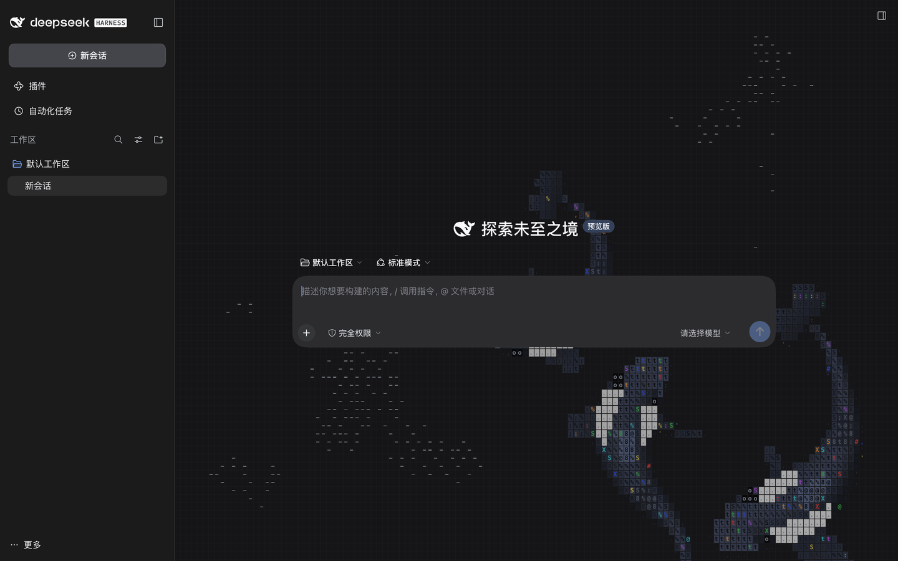
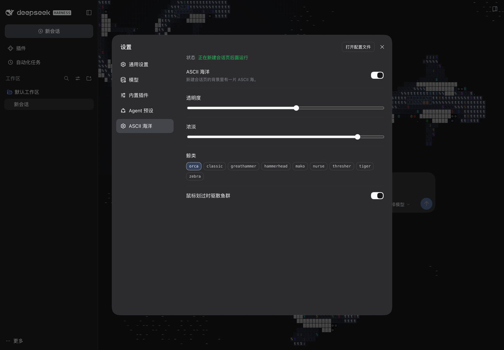

# dsh-ascii-sharks

DeepSeek Harness 的 ASCII 海洋背景：新建会话页上，一片字符画的海。

几群真会躲虎鲸的鱼，几头真会追鱼的虎鲸。明暗主题自适应，整体半透明，离屏即停，鼠标划过会惊散鱼群。

> ## ⚠️ 先读 [NOTICE.md](NOTICE.md)
>
> 这个项目的引擎移植自 [**stackedlol/ascii-sharks**](https://github.com/stackedlol/ascii-sharks)，而**上游没有 LICENSE 文件**。
> **本仓库没有许可证**（没有 LICENSE 文件，也不是 MIT）。因为移植进来的引擎本身没有授权，给整个仓库挂开源许可证会误导人。
> 自己用、本地跑、读代码没问题；要复用到自己项目、公司部署或商用，请先向[上游作者](https://github.com/stackedlol/ascii-sharks/issues/1)取得授权。详见 [NOTICE.md](NOTICE.md)。
>
> 授权请求已于 2026-10-21 [在上游 issue #1 留言](https://github.com/stackedlol/ascii-sharks/issues/1#issuecomment-6312209674)，**目前等回复**。取得授权后这里会换成正式 LICENSE；被拒绝则重写受影响的五个文件。

<p>
  
  
  
</p>
引擎移植自 [stackedlol/ascii-sharks](https://github.com/stackedlol/ascii-sharks)，**重写为一个 DSH 客户端插件**：宿主生命周期、明暗主题、整体透明度、虎鲸外形都是新加的。授权见 [NOTICE.md](NOTICE.md)。





## 它做了什么

- **只在新建会话页出现。** 有会话在屏幕上时，背景里动的东西就是阅读成本，所以海洋随 hero 相位挂载、随会话激活卸载。
- **真的人工生命，不是循环动画。** 鱼是 boids（分离/对齐/聚合）+ Couzin 分区，每条鱼背后有 127° 盲区；恐慌沿鱼群逐跳传递，所以整群会突然炸开，即便只有边缘几条真的看见了鲨鱼。鲨鱼是 20 节点脊髓 + follow-the-leader，转弯半径随速度变大，饥饿度累积、吃到鱼才下降，且偏好抓落单的鱼。
- **随机换种，每只各自抽。** 「整群种类」里点「随机」，每头鲸鱼独立抽自己的种类，每次回到新建会话页重新抽过。重复是允许的 —— 九种里抽三只，撞上同一只是常态；去重会把「随机」悄悄变成「不放回抽样」，那是另一回事。抽取发生在挂载那一刻，所以同一屏里不会边游边变身；存储里记的是「开了随机」，不是抽到的结果。
- **不做纯白高光。** 侧身有一道缓慢的"反光"沿身体扫过。它曾经用纯 `#ffffff`，结果 3.7 秒的周期里有约一秒把最多 50% 的躯干刷成白色字形 —— 肉眼看到的就是"鲸鱼一秒变白"。现在改成灰蓝提亮（`#4a5262`）、波峰用六次方收窄、阈值 0.985：平均覆盖 2.8%，峰值 20%。
- **眼斑按「能认出来」定大小，不按野外比例。** 查过 NOAA 的[虎鲸解剖](https://oceantoday.noaa.gov/killerwhaleanatomy/welcome.html)：虎鲸是反荫蔽色，俯视时背部本来就是黑的。我照着改成「俯视全黑 + 侧缘一条腹色接缝」，结果是技术上说得通、观感上全废 —— 在 40 格的分辨率下，眼斑是唯一能让人认出「这是虎鲸」的特征，抹掉它就只剩一团带背鳍的黑影。现在的做法是：形态保真（分叉尾叶、圆桨胸鳍、高背鳍、眼斑），比例服从格子能承载的信息量。背鳍后那块鞍斑用**灰色**（NOAA 称之为 "grey swoosh"），这一条照实做。
- **九种，零素材。** 外形是数学函数（半宽剖面 + 鳍根位置），现场光栅化成字符格。默认 `orca`，另有 `classic / hammerhead / greathammer / tiger / zebra / mako / thresher / nurse`。
- **分叉尾叶是单独做的几何。** `halfWidth` 从脊柱量起，只能描述左右对称的形状，任何「尾巴」都会被画成一根横杠。所以尾叶是 `shapes.ts` 里的 `flukes` 三个数字（偏移、半宽、后伸），在渲染器里按**尾部自己的坐标系**判定两个椭圆叶瓣；中间留空的那块就是分叉。
- **尾部按鲸类的方式动，不是鱼的方式。** 这是让尾巴「不僵硬」的关键：鱼类左右甩尾，鲸类上下拍尾 —— 俯视看，鱼的尾巴横向扫，鲸的尾巴沿体轴前后伸缩、同时叶瓣开合。第一版给尾叶加了横向甩动，那是鱼的动作装在海豚身上，所以怎么看怎么别扭。现在 `tailBeat`（前后行程 ±0.045L）与 `tailSpan`（开合 0.81–1.19）同由一个 `sh.phase` 驱动、相差四分之一周期，与身体的行波锁相。
- **圆桨胸鳍同理。** 三角形鳍只能画出细长条或长条，`paddle` 用「前缘 + 弦长」按跨距参数化，才能画出圆头的桨叶。实测外露约 5 格，一眼能看见。
- **整体半透明。** 默认 0.6，设置里可调 0.1–1。透明度作用在 canvas 上而不是逐个颜色上，所以网格、尾迹、鱼和虎鲸是同一个系数一起淡下去的，虎鲸才像在水里，而不是浮在水前面。
- **跟着 shell 的明暗走。** 暗色下是亮块挖暗字，亮色下是淡灰底压深字。切主题时海洋当场换色，不用刷新。
- **不开着不干活的循环。** 离屏停、切标签页停、`prefers-reduced-motion` 下只画一帧、DPR 封顶 2、固定 1/60 步长最多补 4 帧。

## 装

```sh
sh scripts/install.sh            # 默认接进 desktop profile
sh scripts/install.sh --profile=web
```

然后**重启 DeepSeek Harness**（宿主启动时才扫描插件清单）。

装完：

- 新建会话页的背景就是这片海；
- `设置` 左侧导航里多一个 **「ASCII 海洋」** 页：顶部是运行状态（正在运行 / 已暂停 / 已关闭 / 系统要求减弱动效），下面依次是透明度、浓淡、**数量（1–5）**、整群种类（含**随机**）、鼠标驱鱼。
- `设置 → 通用设置` 里也有一行快捷开关（透明度、浓淡、物种、鼠标驱鱼）。

> **为什么侧栏「插件」页里看不到它？** 那一页只列 DSH 自己的官方 bundle（`@deepseek-ai/*` 的固定名单），第三方客户端插件不在其中 —— `dsh-visualize`、`dsh-computer-use` 同样不在。`设置 → 内置插件` 那份只读清单列的是各 Agent 预设内部挂的插件，顶层挂载的第三方包也不在里面。所以「设置 → ASCII 海洋」这一页就是它在 DSH 里唯一能被按名字找到的地方，这一页正是为此加的。

默认是 **3 头虎鲸**在不同深度巡游，整体透明度 0.72。数量可在 1–5 之间调。

游速比原版慢：鲸鱼巡航降到 0.58 倍（约 2.4 格/秒），冲刺倍率也从 1.45 收到 1.25；鱼群 0.82 倍 —— 鱼小，同样的像素速度看起来慢得多，减太多会显得停住。

摘除：

```sh
sh scripts/install.sh --uninstall
```

偏好存在浏览器 `localStorage`（键 `dsh-ascii-sharks:v1`），不写进 Host 的设置文档——这是每窗口的视觉口味，不该跨机器同步。

## 开发

```sh
npm install
npm run verify        # 类型检查 + 构建 Host 半区 + 构建浏览器半区

npm run preview       # 生成 preview/harness.js
open preview/index.html   # 带 sidebar/hero/composer 的模拟页
open preview/lab.html     # 外形实验室：八种鲨鱼并排，静止
open preview/parity.html  # 与上游原版同条件（整屏、四条 classic）
```

`preview/` 是开发用的，不进发布包。

### 结构

```
src/
  index.ts        Host 半区：只发布默认值，其余留空（见下）
  entry.ts        浏览器半区入口：注册两个座位，没有渲染逻辑
  surface.tsx     海洋座位：把 canvas 挂进会话列
  settings-row.tsx 设置行（总开关 / 透明度 / 浓淡 / 物种 / 鼠标驱鱼）
  store.ts        共享配置 store（localStorage 后备）
  engine.ts       固定步长循环、resize、指针、透明度、离屏暂停
  world.ts        鱼群与虎鲸/鲨鱼的行为模拟
  renderer.ts     逐格字符光栅化
  shapes.ts       九种外形函数（八种鲨鱼 + 虎鲸）
  species.ts      五种鱼的行为参数表
  math.ts         clamp / 角度差 / 哈希噪声 / 无散度海流
```

### 三个必须知道的约束

1. **浏览器半区必须是一个自包含的 `window.__ModuleLoader__.load()` 调用。** loader 给的 `require` 只认 shell 已经种进平台表的模块（`react`、`react/jsx-runtime`），解析不了本地路径。所以 `scripts/build-client.mjs` 用 esbuild 把引擎打成一个 CommonJS bundle 再套上 loader 信封。React 必须留在 external——打进第二份 React 会让组件拿到另一个 hook dispatcher，每个 hook 都炸。

2. **canvas 挂在会话列里，不挂 `shell.overlay`。** overlay 是 `z-index: 20` 的整框浮层、在每一列之上；把背景画在那儿会盖住内容。挂进列里、给 canvas `z-index: -1` 配 `isolation: isolate`，才是「列底色之上、所有内容之下」——层级是诚实的，不用跟浮层打架。

3. **文案字典要在 `ctx.inject(["locale"], …)` 里注册。** 冷启动时这个 bundle 比 locale 插件先激活，`ctx.get("locale")` 会答 undefined；一次性 `ctx.effect` 在那儿放弃，整个页面生命周期内 namespace 都不会注册，症状是每个标签都渲染成自己的 key。

## 来源

引擎逻辑、行为参数与外形比例移植自 [stackedlol/ascii-sharks](https://github.com/stackedlol/ascii-sharks)（TypeScript，零依赖）。

上游仓库**当时没有 LICENSE 文件**，issue #1「Missing license」还开着。所以本仓库也**不提供许可证** —— 移植进来的部分我没有权利授权给你，原创部分我也选择不授权。想合法复用，先找上游作者。

改动清单：

- 去掉上游的黑底与固定网格画布，改成透明背景 + 自适应主题；
- 上游把鲨鱼活动区绕开居中的标题椭圆，这里改成绕开由宿主测量的 hero 区域（侧栏展开时内容列不是居中的）；
- 新增虎鲸外形与白眼斑/鞍斑（`FLAG_PALE`），并新增整体透明度（作用在 canvas 合成层上）；
- 上游 `base.css` 之外还画了一圈环境点阵，这里去掉——在 DSH 里它和宿主的字符网格打架；
- 指针输入、离屏暂停、可见性暂停、`prefers-reduced-motion` 全部接到宿主生命周期上；
- 新增配置 store、设置行、locale 字典。
